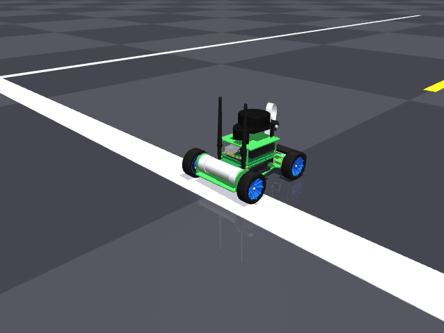
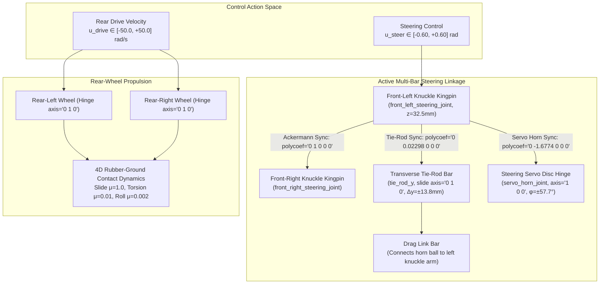
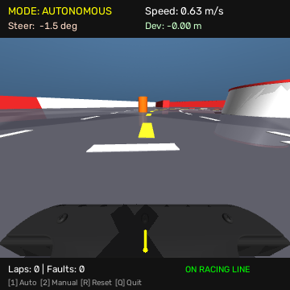
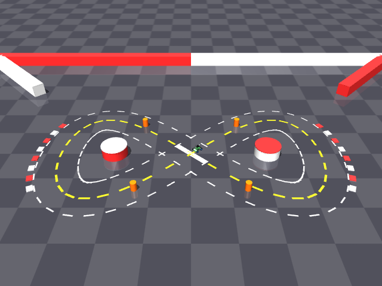
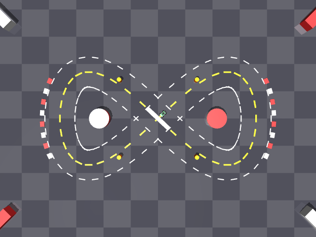

# JetRacer MuJoCo — Sim2Real Reinforcement Learning & Physics Environment

<div align="center">



**High-Fidelity Physics Simulation & Sim2Real Digital Twin for the Waveshare JetRacer Platform**  
*Tailored for Reinforcement Learning, Imitation Learning, Autonomous Navigation, and Zero-Shot Sim2Real Transfer*

[](https://mujoco.org)
[](https://python.org)
[](#-sim2real-physics-fidelity)
[](#-physics-audit--verification-scorecard)
[](https://creativecommons.org/licenses/by/4.0/)

</div>

---

##  Overview

This repository provides a self-contained, physics-audited **MuJoCo simulation environment** (`jetracer.xml`, `scene.xml`) built specifically for training and evaluating **Reinforcement Learning (RL), imitation learning, and optimal control algorithms** destined for real-world deployment on the **Waveshare JetRacer** (NVIDIA Jetson Nano).

Instead of relying on heavy robotics middleware or crude geometric placeholders, this environment provides:
- **Clean Python & MuJoCo Native Interface**: Step physics at over **$1000\times$ real-time** on standard CPU/GPU pipelines.
- **Hardware-Accurate Sim2Real Parity**: 1:1 metric scale, calibrated mass distribution, dynamic steering linkage, and 4D rubber tire friction to minimize the reality gap.
- **Rich Multimodal Observation Space**: Front-facing wide-angle camera, 360-degree planar RPLIDAR A1, 6-axis chassis IMU, and high-resolution wheel encoders.
- **Interactive & Headless Workflows**: Native 3D desktop visualization (`mujoco.viewer`), dual-window camera HUD demo (`demo.py`), and fast headless batch rollouts for policy training.

---

##  Sim2Real Physics Fidelity

To ensure policies trained in MuJoCo transfer cleanly to physical JetRacer hardware without destabilizing or hallucinating traction, every physical attribute has been audited and calibrated against the physical vehicle:

| Physical Parameter | Hardware Ground Truth | MuJoCo Simulation (`jetracer.xml`) | Sim2Real Rationale |
| :--- | :---: | :---: | :--- |
| **Wheelbase** | $152.4\text{ mm}$ ($6.0\text{ in}$) | **$152.4\text{ mm}$** | Preserves exact turning radius & bicycle model geometry |
| **Track Width** | $167.0\text{ mm}$ | **$166.8\text{ mm}$** | Matches lateral load transfer and roll stability |
| **Wheel Diameter** | $65.0\text{ mm}$ | **$65.0\text{ mm}$** ($r = 0.0325\text{ m}$) | Preserves linear velocity: $v = \omega \cdot r$ |
| **Total Mass** | $\sim 1.800\text{ kg}$ | **$1.799\text{ kg}$** | Matches full real hardware build (Jetson, battery, RPLIDAR, motors) |
| **Center of Mass ($z_{\text{CoM}}$)** | Below wheel axle | **$0.0303\text{ m}$** ($30.3\text{ mm}$) | **$+2.2\text{ mm}$ safety margin below axle height** ($z = 32.5\text{ mm}$) |
| **Anti-Tip Stability** | Does not roll over | **$0.13^\circ$ max roll** in hard turns | Offsets top-mounted RPLIDAR A1 turret to prevent vehicle tipping |
| **Tire Contact Dynamics** | Rubber on asphalt | **`condim="4"`** ($\mu_s=1.0, \mu_t=0.01, \mu_r=0.002$) | Models sliding slip, torsional tire scrub, and rolling resistance |
| **LiDAR Scanning Clearance** | 360° unobstructed | **0 self-intersections** across 360° | Antenna/ribbon visual pass-through prevents false blindspots |

---

##  Mechanical & Steering Linkage

The vehicle features an active **Ackermann steering mechanism** and **rear-wheel velocity drive**:



<div align="center">

  
*Active Steering Linkage: Rotating servo horn, translating tie-rod bar, and pivoting steering knuckles.*


</div>

### Steering Geometry Details
- **Kingpin Axis**: Positioned at $y = \pm 0.06094\text{ m}, z = 0.0325\text{ m}$. Wheel hubs sit at $y = \pm 0.0762\text{ m}$ (scrub radius $= 15.3\text{ mm}$).
- **Tie-Rod Bar (`tie_rod`)**: Slides laterally along $+Y$ by $\Delta y = 0.02298 \cdot \theta_{\text{steer}}$ ($\pm 13.8\text{ mm}$ travel at full lock $\pm 0.60\text{ rad}$), maintaining steering arm synchronization.
- **Servo Horn (`servo_horn`)**: Forward-facing disc rotates along $+X$ by $\phi_{\text{horn}} = -1.6774 \cdot \theta_{\text{steer}}$ ($\pm 57.7^\circ$ rotation at full lock $\pm 0.60\text{ rad}$), matching the lateral travel of the drag link ball joint within $0.5\text{ mm}$.

---

##  RL & Learning Environment Interface

> [!TIP]
> **Looking for Deep Reinforcement Learning?**  
> A complete end-to-end RL training pipeline (ResNet-18 Vision SAC, vector PPO, 8-gate checkpoint validation, and broadcast evaluation GIFs) is housed in the dedicated downstream repository: **[`jetracer_rl`](https://github.com/davesh/jetracer_rl)**.  
> To train policies, simply clone this `jetracer_mujoco` asset repo inside `jetracer_rl`!

The MuJoCo model is designed for direct integration with reinforcement learning libraries (Gymnasium, CleanRL, Stable-Baselines3, JAX/MJX):

### Action Space

| Action Channel | MuJoCo Actuator | Control Type | Range | Hardware Unit |
| :--- | :--- | :---: | :---: | :--- |
| **Steering** | `steering` | Position Servo (`kp=25`, `kv=1.5`) | $[-0.60, +0.60]\text{ rad}$ | Steering angle ($\pm 34.4^\circ$, Waveshare ROS `/cmd_vel` standard) |
| **Rear Left Drive** | `rear_left_drive` | Velocity Drive (`kv=0.15`) | $[-50.0, +50.0]\text{ rad/s}$ | Wheel angular velocity ($\pm 1.625\text{ m/s}$) |
| **Rear Right Drive**| `rear_right_drive`| Velocity Drive (`kv=0.15`) | $[-50.0, +50.0]\text{ rad/s}$ | Wheel angular velocity ($\pm 1.625\text{ m/s}$) |

### Observation Space

| Modality | Sensor / Element | Shape / Dimension | Description |
| :--- | :--- | :---: | :--- |
| **Vision (RGB / Depth)**| `front_camera` | `(H, W, 3)` / `(H, W, 1)` | $120^\circ$ FOV camera at $[0.173, 0, 0.106]\text{ m}$, clear of front bumper |
| **Planar LiDAR** | `lidar_site` | `(360,)` array | 360° RPLIDAR A1 range readings via `mj_ray` at $z = 0.137\text{ m}$ |
| **Linear Acceleration** | `imu_accel` | `(3,)` vector | 3-axis accelerometer $[a_x, a_y, a_z]\text{ m/s}^2$ |
| **Angular Velocity** | `imu_gyro` | `(3,)` vector | 3-axis rate gyroscope $[\omega_x, \omega_y, \omega_z]\text{ rad/s}$ |
| **Wheel Encoders** | `rear_*_encoder_*` | `(4,)` vector | Angular positions and velocities for left and right drive wheels |
| **Vehicle Pose & Speed**| `data.qpos`, `data.qvel` | `(7,)` pose, `(6,)` vel | Exact Cartesian ground-truth position, orientation quaternion, and velocities |

### 🚀 Downstream RL Repositories (Modular Setup)

This repository serves as the clean, standalone **MuJoCo Asset & Physics Digital Twin** (`jetracer.xml`, `scene.xml`, `meshes/`). 

If you are developing reinforcement learning training pipelines (e.g. Gymnasium environments, Stable-Baselines3 SAC/PPO, CleanRL, or JAX/MJX) in a dedicated RL repository:

1. **Clone this asset repository** (or add it as a git submodule):
   ```bash
   git clone https://github.com/DebatableMiracle/jetracer_mujoco.git
   ```
2. **Import or link the XML models and meshes** into your RL project workspace:
   ```bash
   cp -r jetracer_mujoco/jetracer.xml jetracer_mujoco/scene.xml jetracer_mujoco/meshes/ path/to/your_rl_repo/
   ```
3. **Recommended MDP & Environment Formulation**:
   - **Control Frequency**: $10.0\text{ Hz}$ ($dt = 0.10\text{ s}$, `frame_skip=50` with $2\text{ ms}$ physics timestep).
   - **Action Space**: 2-DOF continuous: Steering angle $\in [-0.60, +0.60]\text{ rad}$ (fully compliant with Waveshare ROS `angular.x`) and Throttle/Motor velocity $\in [-50.0, +50.0]\text{ rad/s}$ ($\pm 1.625\text{ m/s}$, covering the rated $\pm 1.2\text{ m/s}$ Waveshare ROS `linear.x`).
   - **Camera Observation**: Front-facing wide-angle camera `front_camera` calibrated at a $25.0^\circ$ downward pitch angle with near plane $z_{\text{near}} = 1.1\text{ cm}$, rendering $84\times 84\times 3$ RGB tensors directly into convolutional backbones (e.g. ResNet-18).
   - **Reward & Penalty**: Formulate as minimum-time control with a fixed step penalty (e.g. $-1.0$ per step).
   - **Reset on Fault (No Early Termination)**: Reset the vehicle back to the start line upon track boundary departure or barrier collision rather than terminating the episode early; this prevents early-termination reward-hacking.
   - **Checkpoint Gate Sequencer**: Partition the Figure-8 track into 8 sequential checkpoint gates (Lemniscate loops) requiring monotonic gate clearance to prevent shortcutting across the center intersection.

---

##  Simulation Snapshots

<div align="center">

| Front-Quarter Isometric | Side Profile & Axle Seating | Top Deck & LiDAR View |
| :---: | :---: | :---: |
|  |  |  |

</div>

---

##  Physics Audit & Verification Scorecard

Run the comprehensive automated test suite:

```bash
python3 test_rollout.py
```

### Verification Results

```text
==============================================================================
 VERIFICATION SUMMARY & COMPLIANCE SCORECARD
==============================================================================
 [1] Kinematics & Dimensional Parity (152mm WB, 167mm TW, 65mm Wheel): PASS [OK]
 [2] Low Center of Mass (z_com = 30.3mm < 32.5mm axle height):         PASS [OK]
 [3] Ackermann Steering Coupling & Rear Drive Velocity Actuators:      PASS [OK]
 [4] Full Sensor Suite (Camera, RPLIDAR A1, Encoders, IMU):            PASS [OK]
 [5] Dynamic Straight-Line & Figure-Eight Rollout:                     PASS [OK]
 [6] Zero Self-Occlusion 360° LiDAR Planar Scan:                       PASS [OK]
 [7] Clean Contact Hygiene & Anti-Tip Stability:                       PASS [OK]
==============================================================================
 >>> ALL PHYSICS & KINEMATIC CHECKS PASSED SUCCESSFULLY! <<<
```

- **Ackermann Steer Tracking Error**: Maximum tracking error between knuckles is **$0.00073\text{ rad}$ ($0.04^\circ$)**.
- **Anti-Tip Stability**: Peak vehicle roll under high-speed cornering ($1.53\text{ rad/s}$ yaw rate) is only **$0.13^\circ$** (safety threshold $< 2.0^\circ$). Zero vehicle rollover.
- **LiDAR Planar Raycasting**: 360 of 360 rays clear the vehicle body with **0 false self-hits**.

---

##  Quick Start & Usage

### 1. Requirements

Install MuJoCo and scientific Python packages:

```bash
pip install mujoco trimesh coacd numpy matplotlib pillow
```

### 2. Run the Physics Test Suite

Verify all kinematics, actuators, and sensors in headless mode:

```bash
python3 test_rollout.py
```

### 3. Interactive 3D Viewer & Visualizer

Launch the native hardware-accelerated 3D MuJoCo viewer:

```bash
python3 -m mujoco.viewer --mjcf=scene.xml
```

Or run the full interactive demo with autonomous figure-8 driving and real-time front-camera HUD:

```bash
python3 demo.py
```

### 4. Real-Time Keyboard Driving (WASD Teleoperation)

Open a terminal window and run:

```bash
python3 teleop.py
```

| Key | Action | Function |
| :---: | :--- | :--- |
| **`W`** / **`↑`** | Throttle Forward | Accelerate rear drive wheels ($+6\text{ rad/s}$ per tap up to $36.9\text{ rad/s}$ / $1.2\text{ m/s}$) |
| **`S`** / **`↓`** | Reverse / Brake | Reverse drive / active deceleration |
| **`A`** / **`←`** | Steer Left | Pivots front steering knuckles left (up to $+0.60\text{ rad}$ / $+34.4^\circ$) |
| **`D`** / **`→`** | Steer Right | Pivots front steering knuckles right (up to $-0.60\text{ rad}$ / $-34.4^\circ$) |
| **`SPACE`** | Coast / Neutral | Instantly cuts throttle and centers steering |
| **`B`** | Active Handbrake | Emergency stop |
| **`R`** | Reset to Start Line | Spawns vehicle back at start line |
| **`1`** | Autonomous Lap Mode | Car drives closed-loop Figure-8 laps smoothly |
| **`2`** | Manual WASD Mode | Returns full manual control to the keyboard / UI sliders |
| **`Q`** | Quit | Safely parks the car and exits teleop |

*Note: You can also drag the `steering` and `rear_left_drive` sliders directly in the MuJoCo viewer's **Control** panel!*

### 5. Interactive Figure-8 Demo with Live Camera Feed (`demo.py`)

Run the standalone interactive demo featuring dual synchronized desktop windows (3D World View + Robot Eye Camera HUD):

```bash
python3 demo.py
```

<div align="center">

| Robot Eye (IMX219) with Real-Time HUD | Figure-8 Track Arena Overview | Birds-Eye Top-Down View |
| :---: | :---: | :---: |
|  |  |  |

</div>

- **Windows Launched**:
  1. `[3D World View]`: Native interactive MuJoCo passive viewer window with mouse orbit, pan, and zoom.
  2. `[JetRacer Eye]`: Live front CSI camera feed (`front_camera`, calibrated $25.0^\circ$ downward pitch) with real-time telemetry HUD overlay.
- **Interactive Controls**:
  - `[1]`: Autonomous Pure-Pursuit lap driving along the Figure-8 racing line.
  - `[2]`: Manual keyboard WASD driving mode.
  - `[R]`: Reset car back to the starting line.
  - `[SPACE]`: Coast / Neutral.
  - `[Q]` / `ESC`: Quit demo.

### 6. Minimal Python Stepping Loop (Asset Integration Skeleton)

```python
import mujoco
import numpy as np

# Load the test track scene
model = mujoco.MjModel.from_xml_path("scene.xml")
data = mujoco.MjData(model)

# Actuator IDs
steer_id = model.actuator("steering").id
drive_l_id = model.actuator("rear_left_drive").id
drive_r_id = model.actuator("rear_right_drive").id

# Step environment
for step in range(1000):
    # Action: steer angle (rad) and rear drive velocity (rad/s)
    data.ctrl[steer_id] = 0.25 * np.sin(step * 0.01)
    data.ctrl[drive_l_id] = 20.0
    data.ctrl[drive_r_id] = 20.0

    mujoco.mj_step(model, data)

    # Observations:
    speed = np.linalg.norm(data.qvel[:3])
    accel = data.sensor("imu_accel").data
    gyro = data.sensor("imu_gyro").data
    l_rpm = data.sensor("rear_left_encoder_vel").data[0] * 60.0 / (2.0 * np.pi)
```

---

## 📁 Repository Structure

```text
jetracer_mujoco/
├── jetracer.xml                  # Primary MuJoCo Sim2Real model (Z-up, 1.8kg, active linkage, 25° cam)
├── scene.xml                     # Track scene with asphalt, red/white barriers, yellow dashes, and cameras
├── demo.py                       # Interactive Figure-8 demo (Autonomous laps, WASD manual, live camera HUD)
├── teleop.py                     # Real-time interactive keyboard teleoperation (WASD & Arrows)
├── test_rollout.py               # 7-point automated physics & sensor audit script
├── sim_plugin.py                 # Studio sim plugin: vehicle modes, telemetry, and steering logic
├── messages.py                   # Studio message definitions (DriveCommand, JetRacerTelemetry)
├── convert_glb_sim2real.py       # CAD conversion pipeline: coordinate transform, coacd hulls, submeshes
├── build_sim2real_xml.py         # Programmatic XML builder with calibrated mass & equality constraints
│
├── meshes/
│   ├── glb_sim2real/             # Processed 1:1 metric visual meshes and coacd convex hulls (.obj)
│   └── waveshare-jetracer-for-sim2real/ # Source CAD GLB model (CC-BY Caldorf)
│
├── jetracer_steering_linkage.gif # Animated close-up of active steering linkage in action
├── jetracer_track_rollout.gif    # Animated track driving rollout
├── steering_linkage_comparison.png # 3-state comparison sheet of the front steering mechanism
├── snapshot_camera_hud.png       # Live front CSI camera feed with telemetry HUD
├── snapshot_track_overview.png   # Perspective overview of the Figure-8 track arena
├── snapshot_track_birds_eye.png  # Top-down birds-eye view of the Figure-8 track
└── snapshot_front_quarter_sim2real.png # High-resolution rendering of the assembled asset
```

---

##  Attribution & License

- **CAD Model**: Base 3D geometry derived from *Waveshare JetRacer for Sim2Real* by **Caldorf**, licensed under [Creative Commons Attribution (CC-BY 4.0)](https://creativecommons.org/licenses/by/4.0/).
- **MuJoCo Asset & Kinematics**: Authored and physics-calibrated for high-fidelity Sim2Real robotics and reinforcement learning workflows.
